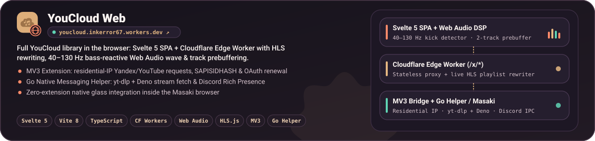
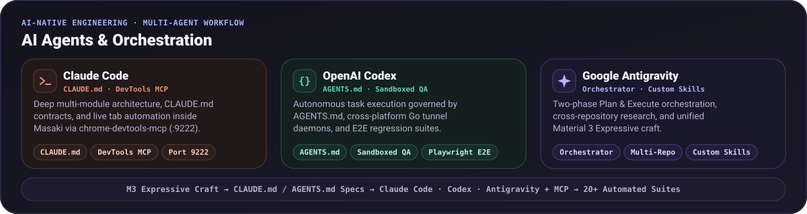
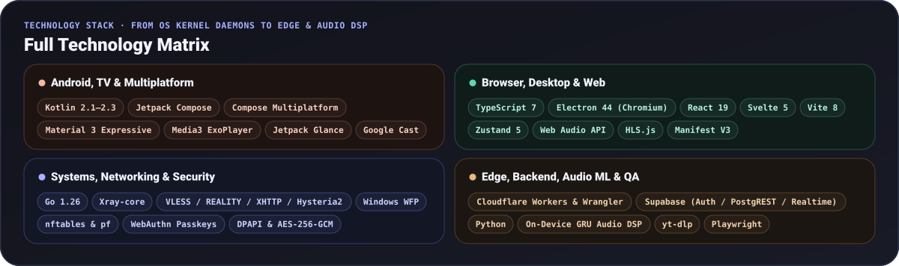

<a href="https://github.com/GXUser7/GXUser7/blob/main/README.md">← Русский</a> &nbsp;·&nbsp; <b>English</b> &nbsp;·&nbsp; <a href="https://yumi.inkerror67.workers.dev">Yumi Group</a> &nbsp;·&nbsp; <a href="https://youcloud.inkerror67.workers.dev">YouCloud Web</a> &nbsp;·&nbsp; <a href="https://t.me/MaterialYouCloud">Telegram</a>

  

<a href="https://yumi.inkerror67.workers.dev">
  <picture>
    <source media="(prefers-color-scheme: dark)" srcset="assets/hero-en-dark.svg">
    <source media="(prefers-color-scheme: light)" srcset="assets/hero-en-light.svg">
    
  </picture>
</a>

 

<table>
  <tr>
    <td width="50%">
      <a href="https://github.com/GXUser7/Masaki">
        <picture>
          <source media="(prefers-color-scheme: dark)" srcset="assets/card-masaki-en-dark.svg">
          <source media="(prefers-color-scheme: light)" srcset="assets/card-masaki-en-light.svg">
          
        </picture>
      </a>
    </td>
    <td width="50%">
      <a href="https://github.com/GXUser7/YouCloud">
        <picture>
          <source media="(prefers-color-scheme: dark)" srcset="assets/card-youcloud-en-dark.svg">
          <source media="(prefers-color-scheme: light)" srcset="assets/card-youcloud-en-light.svg">
          
        </picture>
      </a>
    </td>
  </tr>
  <tr>
    <td width="50%">
      <a href="https://github.com/GXUser7/yumi">
        <picture>
          <source media="(prefers-color-scheme: dark)" srcset="assets/card-yumi-en-dark.svg">
          <source media="(prefers-color-scheme: light)" srcset="assets/card-yumi-en-light.svg">
          
        </picture>
      </a>
    </td>
    <td width="50%">
      <a href="https://github.com/GXUser7/yumi-desktop">
        <picture>
          <source media="(prefers-color-scheme: dark)" srcset="assets/card-yumi-desktop-en-dark.svg">
          <source media="(prefers-color-scheme: light)" srcset="assets/card-yumi-desktop-en-light.svg">
          
        </picture>
      </a>
    </td>
  </tr>
  <tr>
    <td colspan="2">
      <a href="https://youcloud.inkerror67.workers.dev">
        <picture>
          <source media="(prefers-color-scheme: dark)" srcset="assets/card-youcloud-web-en-dark.svg">
          <source media="(prefers-color-scheme: light)" srcset="assets/card-youcloud-web-en-light.svg">
          
        </picture>
      </a>
    </td>
  </tr>
</table>

[Launch YouCloud Web](https://youcloud.inkerror67.workers.dev) &nbsp;·&nbsp; [YouCloud/web Source](https://github.com/GXUser7/YouCloud/tree/main/web) &nbsp;·&nbsp; [Lumi Launcher](https://github.com/GXUser7/Lumi-launcher) &nbsp;·&nbsp; [Yumi Group Website](https://yumi.inkerror67.workers.dev)

 

<picture>
  <source media="(prefers-color-scheme: dark)" srcset="assets/ai-workflow-en-dark.svg">
  <source media="(prefers-color-scheme: light)" srcset="assets/ai-workflow-en-light.svg">
  
</picture>

  

<picture>
  <source media="(prefers-color-scheme: dark)" srcset="assets/tech-stack-en-dark.svg">
  <source media="(prefers-color-scheme: light)" srcset="assets/tech-stack-en-light.svg">
  
</picture>

  

