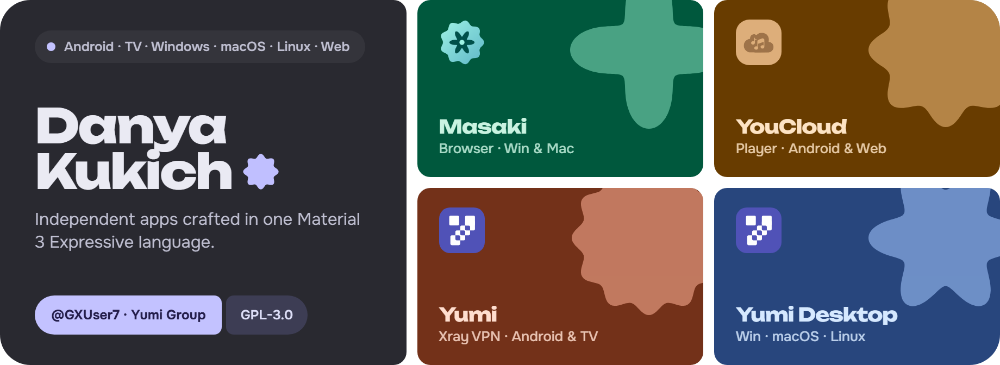
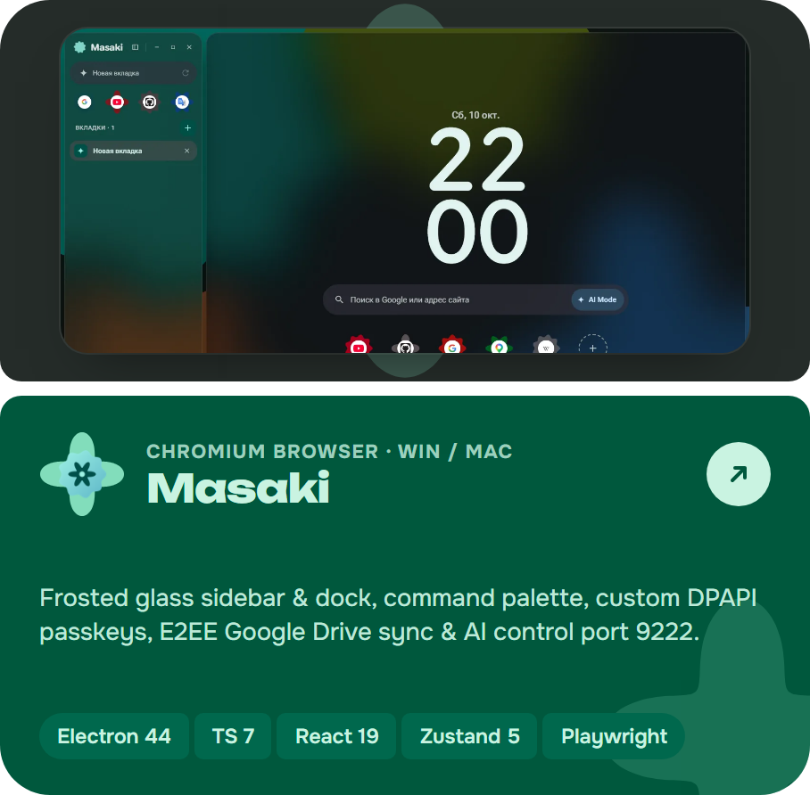
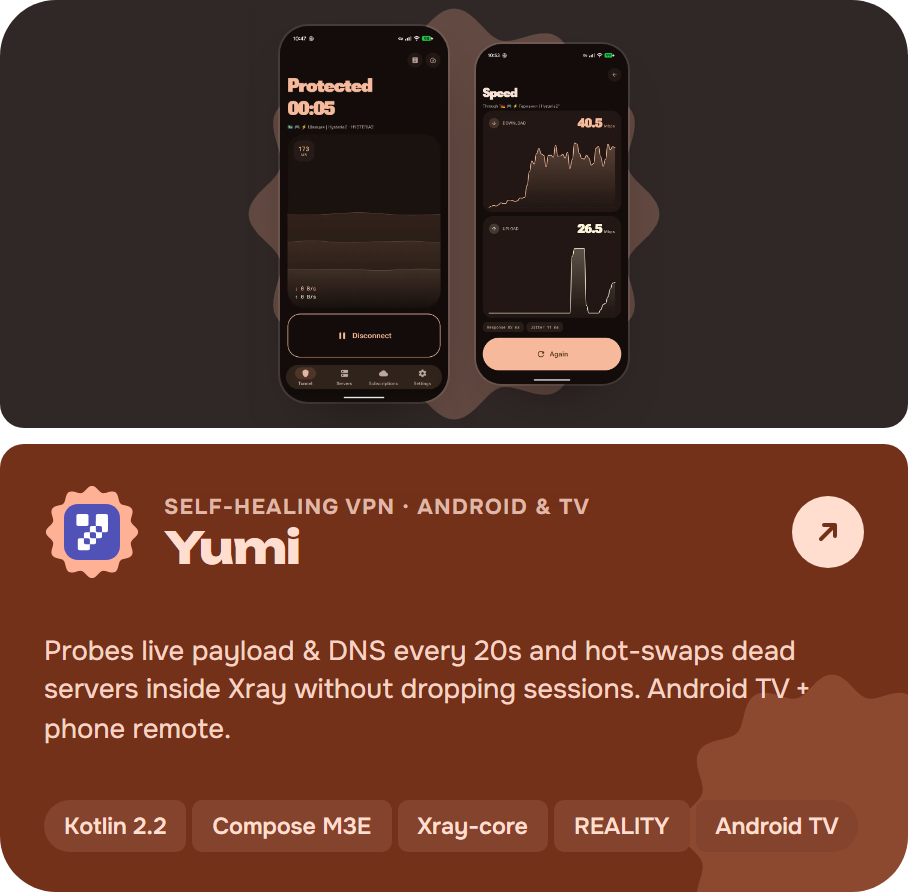
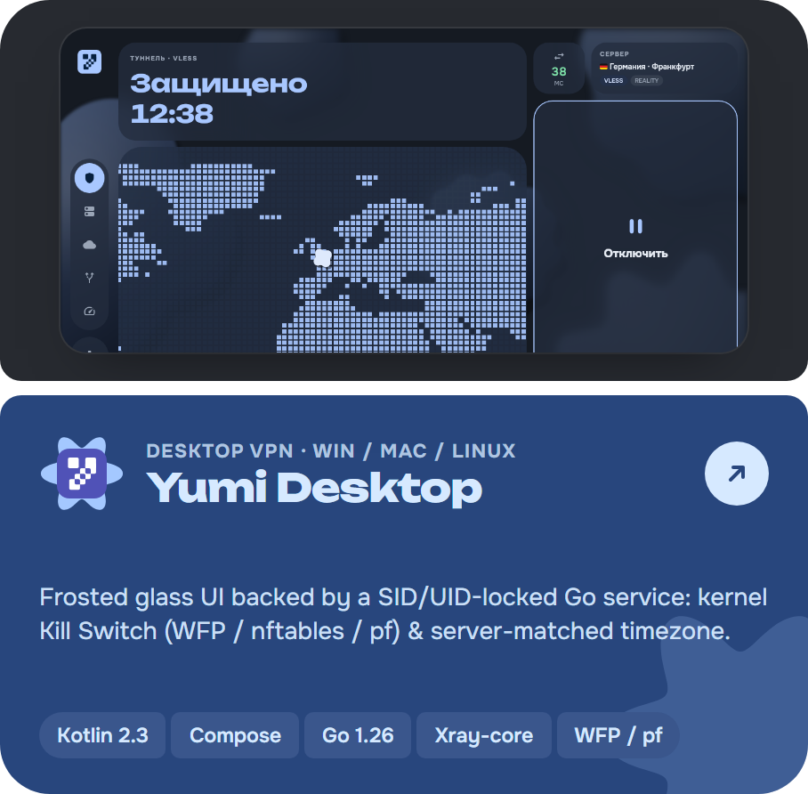
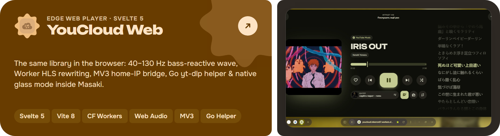
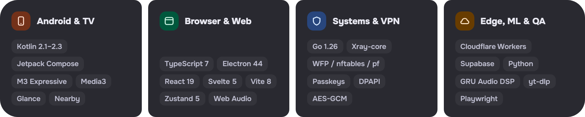

  <a href="https://github.com/GXUser7/GXUser7/blob/main/README.md">← Русский</a> &nbsp;·&nbsp; <b>English</b> &nbsp;·&nbsp; <a href="https://yumi.inkerror67.workers.dev">Yumi Group</a> &nbsp;·&nbsp; <a href="https://youcloud.inkerror67.workers.dev">YouCloud Web</a> &nbsp;·&nbsp; <a href="https://t.me/MaterialYouCloud">Telegram</a>

  <a href="https://yumi.inkerror67.workers.dev"><picture><source media="(prefers-color-scheme: dark)" srcset="assets/hero-en-dark.png"><source media="(prefers-color-scheme: light)" srcset="assets/hero-en-light.png"></picture></a>

  <a href="https://github.com/GXUser7/Masaki"><picture><source media="(prefers-color-scheme: dark)" srcset="assets/card-masaki-en-dark.png"><source media="(prefers-color-scheme: light)" srcset="assets/card-masaki-en-light.png"></picture></a>&nbsp;&nbsp;<a href="https://github.com/GXUser7/YouCloud"><picture><source media="(prefers-color-scheme: dark)" srcset="assets/card-youcloud-en-dark.png"><source media="(prefers-color-scheme: light)" srcset="assets/card-youcloud-en-light.png"></picture></a>

  <a href="https://github.com/GXUser7/yumi"><picture><source media="(prefers-color-scheme: dark)" srcset="assets/card-yumi-en-dark.png"><source media="(prefers-color-scheme: light)" srcset="assets/card-yumi-en-light.png"></picture></a>&nbsp;&nbsp;<a href="https://github.com/GXUser7/yumi-desktop"><picture><source media="(prefers-color-scheme: dark)" srcset="assets/card-yumi-desktop-en-dark.png"><source media="(prefers-color-scheme: light)" srcset="assets/card-yumi-desktop-en-light.png"></picture></a>

  <a href="https://youcloud.inkerror67.workers.dev"><picture><source media="(prefers-color-scheme: dark)" srcset="assets/card-youcloud-web-en-dark.png"><source media="(prefers-color-scheme: light)" srcset="assets/card-youcloud-web-en-light.png"></picture></a>

  <a href="https://youcloud.inkerror67.workers.dev">Launch YouCloud Web</a> &nbsp;·&nbsp; <a href="https://github.com/GXUser7/YouCloud/tree/main/web">YouCloud/web Source</a> &nbsp;·&nbsp; <a href="https://github.com/GXUser7/Lumi-launcher">Lumi Launcher</a> &nbsp;·&nbsp; <a href="https://yumi.inkerror67.workers.dev">Yumi Group Website</a>

  <picture><source media="(prefers-color-scheme: dark)" srcset="assets/bento-stack-en-dark.png"><source media="(prefers-color-scheme: light)" srcset="assets/bento-stack-en-light.png"></picture>

  
  
  
  
  
  

