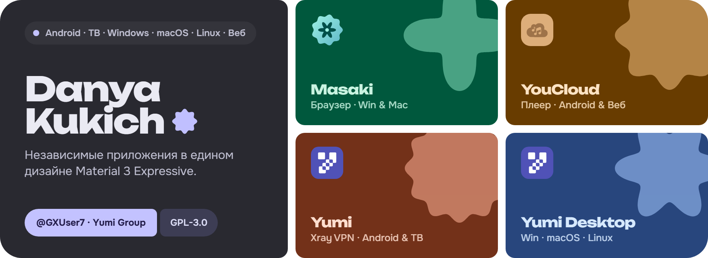
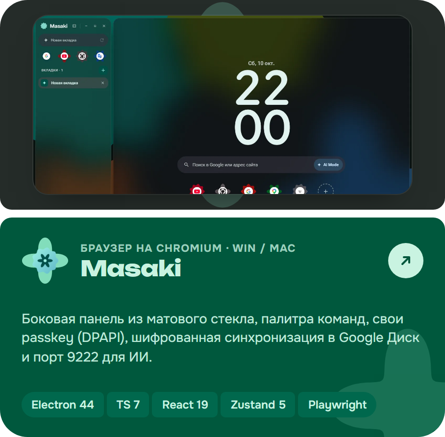
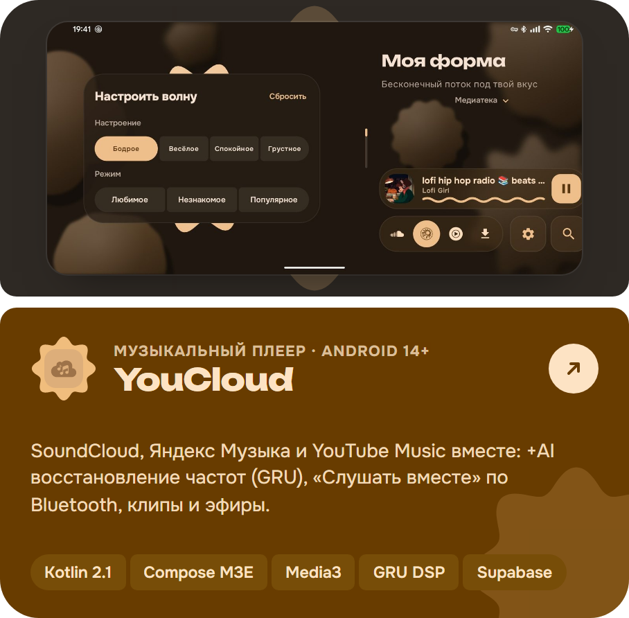
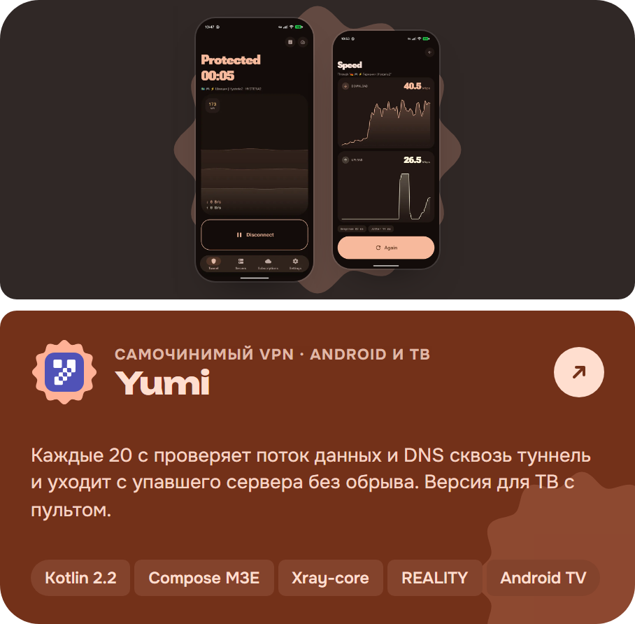
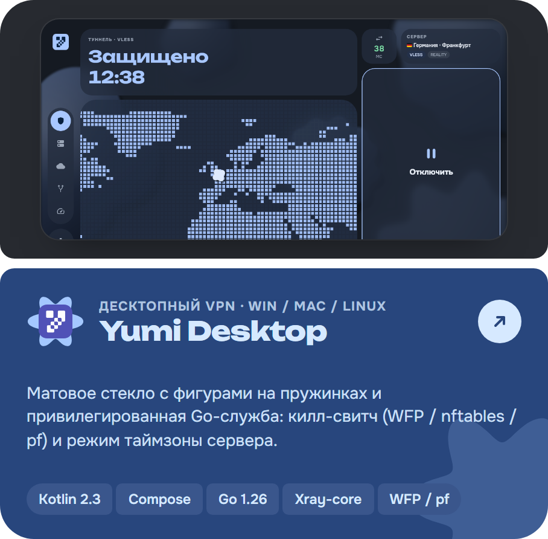
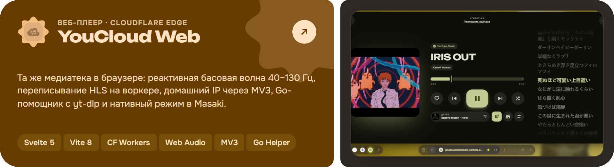
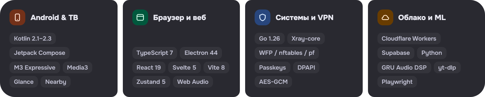

  <b>Русский</b> &nbsp;·&nbsp; <a href="https://github.com/GXUser7/GXUser7/blob/main/README.en.md">English ↗</a> &nbsp;·&nbsp; <a href="https://yumi.inkerror67.workers.dev">Yumi Group</a> &nbsp;·&nbsp; <a href="https://youcloud.inkerror67.workers.dev">YouCloud Web</a> &nbsp;·&nbsp; <a href="https://t.me/MaterialYouCloud">Telegram</a>

  <a href="https://yumi.inkerror67.workers.dev"><picture><source media="(prefers-color-scheme: dark)" srcset="assets/hero-ru-dark.png"><source media="(prefers-color-scheme: light)" srcset="assets/hero-ru-light.png"></picture></a>

  <a href="https://github.com/GXUser7/Masaki"><picture><source media="(prefers-color-scheme: dark)" srcset="assets/card-masaki-ru-dark.png"><source media="(prefers-color-scheme: light)" srcset="assets/card-masaki-ru-light.png"></picture></a>&nbsp;&nbsp;<a href="https://github.com/GXUser7/YouCloud"><picture><source media="(prefers-color-scheme: dark)" srcset="assets/card-youcloud-ru-dark.png"><source media="(prefers-color-scheme: light)" srcset="assets/card-youcloud-ru-light.png"></picture></a>

  <a href="https://github.com/GXUser7/yumi"><picture><source media="(prefers-color-scheme: dark)" srcset="assets/card-yumi-ru-dark.png"><source media="(prefers-color-scheme: light)" srcset="assets/card-yumi-ru-light.png"></picture></a>&nbsp;&nbsp;<a href="https://github.com/GXUser7/yumi-desktop"><picture><source media="(prefers-color-scheme: dark)" srcset="assets/card-yumi-desktop-ru-dark.png"><source media="(prefers-color-scheme: light)" srcset="assets/card-yumi-desktop-ru-light.png"></picture></a>

  <a href="https://youcloud.inkerror67.workers.dev"><picture><source media="(prefers-color-scheme: dark)" srcset="assets/card-youcloud-web-ru-dark.png"><source media="(prefers-color-scheme: light)" srcset="assets/card-youcloud-web-ru-light.png"></picture></a>

  <a href="https://youcloud.inkerror67.workers.dev">Открыть YouCloud Web</a> &nbsp;·&nbsp; <a href="https://github.com/GXUser7/YouCloud/tree/main/web">Исходники YouCloud/web</a> &nbsp;·&nbsp; <a href="https://github.com/GXUser7/Lumi-launcher">Lumi Launcher</a> &nbsp;·&nbsp; <a href="https://yumi.inkerror67.workers.dev">Сайт Yumi Group</a>

  <picture><source media="(prefers-color-scheme: dark)" srcset="assets/bento-stack-ru-dark.png"><source media="(prefers-color-scheme: light)" srcset="assets/bento-stack-ru-light.png"></picture>

  
  
  
  
  
  

<b>Read in English — Projects &amp; Architecture</b>

 

Full visual English showcase: **[README.en.md](https://github.com/GXUser7/GXUser7/blob/main/README.en.md)**

- **[Masaki](https://github.com/GXUser7/Masaki)** — Frosted-glass Chromium browser (Windows / macOS): Electron 44, TypeScript 7, React 19, Zustand 5, custom DPAPI WebAuthn passkeys, AES-256-GCM Google Drive sync, Ghostery adblock, Chrome Web Store extensions, native YouCloud bridge, and AI control port `:9222` (`chrome-devtools-mcp`).
- **[YouCloud](https://github.com/GXUser7/YouCloud)** — Unified Android 14+ music player for SoundCloud, Yandex Music &amp; YouTube Music: Kotlin 2.1, Jetpack Compose + M3 Expressive, Media3 Dual-ExoPlayer crossfade, pure-Kotlin GRU neural audio upscaling (`+AI`), P2P Listen Together via Nearby Connections, Supabase Realtime, Jetpack Glance, and Google Cast.
- **[YouCloud Web](https://github.com/GXUser7/YouCloud/tree/main/web)** ([live](https://youcloud.inkerror67.workers.dev)) — Browser edition built with Svelte 5, Vite 8, Cloudflare Workers (`/x/*` proxy &amp; live HLS rewrite), Web Audio API 40–130 Hz bass-reactive wave, Manifest V3 residential-IP bridge, and Go Native Messaging helper (`yt-dlp` + Deno + Discord IPC).
- **[Yumi](https://github.com/GXUser7/yumi)** — Self-healing Xray VPN for Android &amp; Android TV: Kotlin 2.2, Jetpack Compose, `VLESS` (`REALITY`, `Vision`, `XHTTP`), `Hysteria2`, `WireGuard`, 20s in-tunnel payload &amp; DNS probes with automatic failover, and LAN Phone-as-Remote TV control.
- **[Yumi Desktop](https://github.com/GXUser7/yumi-desktop)** — Cross-platform desktop VPN (Windows / macOS / Linux): Kotlin 2.3 + Compose UI backed by a SID/UID-locked Go 1.26 daemon (`YumiTunnel`), kernel-level Kill Switch (`WFP` / `nftables` / `pf`), "Location as Server" timezone &amp; geo-silencing, and `geoip`/`geosite` direct routing.

