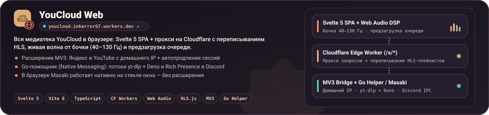
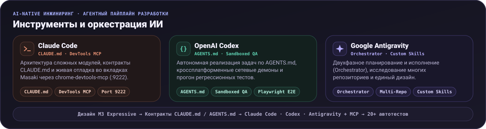
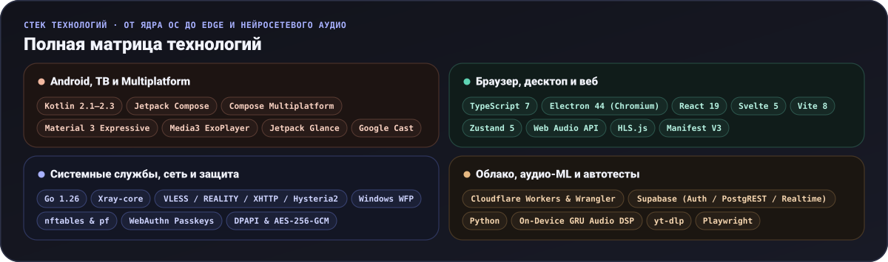

<b>Русский</b> &nbsp;·&nbsp; <a href="https://github.com/GXUser7/GXUser7/blob/main/README.en.md">English ↗</a> &nbsp;·&nbsp; <a href="https://yumi.inkerror67.workers.dev">Yumi Group</a> &nbsp;·&nbsp; <a href="https://youcloud.inkerror67.workers.dev">YouCloud Web</a> &nbsp;·&nbsp; <a href="https://t.me/MaterialYouCloud">Telegram</a>

  

<a href="https://yumi.inkerror67.workers.dev">
  <picture>
    <source media="(prefers-color-scheme: dark)" srcset="assets/hero-ru-dark.svg">
    <source media="(prefers-color-scheme: light)" srcset="assets/hero-ru-light.svg">
    
  </picture>
</a>

 

<table>
  <tr>
    <td width="50%">
      <a href="https://github.com/GXUser7/Masaki">
        <picture>
          <source media="(prefers-color-scheme: dark)" srcset="assets/card-masaki-ru-dark.svg">
          <source media="(prefers-color-scheme: light)" srcset="assets/card-masaki-ru-light.svg">
          
        </picture>
      </a>
    </td>
    <td width="50%">
      <a href="https://github.com/GXUser7/YouCloud">
        <picture>
          <source media="(prefers-color-scheme: dark)" srcset="assets/card-youcloud-ru-dark.svg">
          <source media="(prefers-color-scheme: light)" srcset="assets/card-youcloud-ru-light.svg">
          
        </picture>
      </a>
    </td>
  </tr>
  <tr>
    <td width="50%">
      <a href="https://github.com/GXUser7/yumi">
        <picture>
          <source media="(prefers-color-scheme: dark)" srcset="assets/card-yumi-ru-dark.svg">
          <source media="(prefers-color-scheme: light)" srcset="assets/card-yumi-ru-light.svg">
          
        </picture>
      </a>
    </td>
    <td width="50%">
      <a href="https://github.com/GXUser7/yumi-desktop">
        <picture>
          <source media="(prefers-color-scheme: dark)" srcset="assets/card-yumi-desktop-ru-dark.svg">
          <source media="(prefers-color-scheme: light)" srcset="assets/card-yumi-desktop-ru-light.svg">
          
        </picture>
      </a>
    </td>
  </tr>
  <tr>
    <td colspan="2">
      <a href="https://youcloud.inkerror67.workers.dev">
        <picture>
          <source media="(prefers-color-scheme: dark)" srcset="assets/card-youcloud-web-ru-dark.svg">
          <source media="(prefers-color-scheme: light)" srcset="assets/card-youcloud-web-ru-light.svg">
          
        </picture>
      </a>
    </td>
  </tr>
</table>

[Открыть YouCloud Web](https://youcloud.inkerror67.workers.dev) &nbsp;·&nbsp; [Исходники YouCloud/web](https://github.com/GXUser7/YouCloud/tree/main/web) &nbsp;·&nbsp; [Lumi Launcher](https://github.com/GXUser7/Lumi-launcher) &nbsp;·&nbsp; [Сайт Yumi Group](https://yumi.inkerror67.workers.dev)

 

<picture>
  <source media="(prefers-color-scheme: dark)" srcset="assets/ai-workflow-ru-dark.svg">
  <source media="(prefers-color-scheme: light)" srcset="assets/ai-workflow-ru-light.svg">
  
</picture>

  

<picture>
  <source media="(prefers-color-scheme: dark)" srcset="assets/tech-stack-ru-dark.svg">
  <source media="(prefers-color-scheme: light)" srcset="assets/tech-stack-ru-light.svg">
  
</picture>

  

 

<b>Read in English — Projects, Architecture &amp; AI Workflow</b>

 

> Looking for the full visual English edition? Open **[README.en.md](https://github.com/GXUser7/GXUser7/blob/main/README.en.md)**.

### Ecosystem Overview

| Project | Platform &amp; Role | Key Engineering &amp; Stack |
|---|---|---|
| **[Masaki](https://github.com/GXUser7/Masaki)** | Frosted-glass Chromium browser (Windows / macOS) | TypeScript 7, Electron 44, React 19, Zustand 5, custom DPAPI WebAuthn passkeys, AES-256-GCM Google Drive sync, Ghostery adblock, Chrome Web Store extensions, AI port `:9222` (`chrome-devtools-mcp`) |
| **[YouCloud](https://github.com/GXUser7/YouCloud)** | Unified music player (Android 14+) | Kotlin 2.1, Jetpack Compose + M3 Expressive, Media3 Dual-ExoPlayer crossfade, pure-Kotlin GRU neural audio upscaling (`+AI`), Google Nearby P2P Listen Together, Supabase Realtime, Jetpack Glance, Google Cast |
| **[YouCloud Web](https://github.com/GXUser7/YouCloud/tree/main/web)** | Browser edition ([live](https://youcloud.inkerror67.workers.dev)) | Svelte 5, Vite 8, Cloudflare Workers (`/x/*` proxy &amp; live HLS rewrite), Web Audio API 40–130 Hz bass wave, MV3 residential-IP bridge, Go Native Messaging helper (`yt-dlp` + Deno + Discord IPC), zero-extension Masaki integration |
| **[Yumi](https://github.com/GXUser7/yumi)** | Self-healing VPN client (Android &amp; Android TV) | Kotlin 2.2, Jetpack Compose, Xray-core (`VLESS`, `REALITY`, `XHTTP`, `Hysteria2`, `WireGuard`), 20s in-tunnel payload &amp; DNS probes with automatic failover, LAN QR &amp; Phone-as-Remote TV control |
| **[Yumi Desktop](https://github.com/GXUser7/yumi-desktop)** | Cross-platform desktop VPN (Win / macOS / Linux) | Kotlin 2.3 + Compose Multiplatform UI, privileged Go 1.26 service (`YumiTunnel`), kernel Kill Switch (`WFP` / `nftables` / `pf`), "Location as Server" timezone &amp; geo-silencing, `geoip`/`geosite` direct routing |

### AI-Native Development Stack

- **Claude Code** — Multi-module architecture, `CLAUDE.md` engineering contracts, and live UI inspection inside Masaki tabs via `chrome-devtools-mcp` (`127.0.0.1:9222`).
- **OpenAI Codex** — Spec-driven implementation via `AGENTS.md`, cross-platform privileged Go services, and Playwright E2E regression runs.
- **Google Antigravity** — Two-phase `Orchestrator` planning &amp; execution, multi-repository exploration, custom skills &amp; rules.

